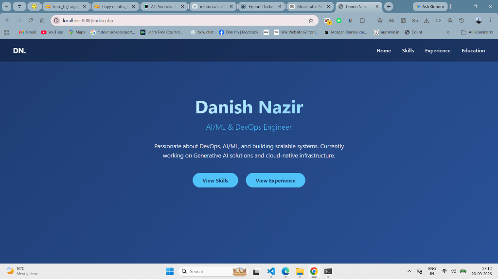

# Lab 64: Docker Compose Introduction — Deploy Portfolio Stack


---

## 📌 Lab Overview & Real-World DevOps Context

In **Labs 57–63**, we deployed Danish's multi-container portfolio stack (PHP 8.2 + PostgreSQL 15) using a long chain of manual `docker` commands:

```bash
# Manual multi-container deployment (Labs 57–63)
docker network create portfolio-net
docker volume create portfolio-pgdata
docker run -d --name portfolio-db --network portfolio-net -e POSTGRES_DB=... -v portfolio-pgdata:/var/lib/postgresql/data postgres:15
docker run -d --name portfolio-app --network portfolio-net -p 8080:80 danish-portfolio:1.0
```

This approach had critical **production drawbacks**:

| Problem | Impact |
| :--- | :--- |
| **Command Sprawl** | 4+ separate `docker run` commands to memorize and execute in the correct order |
| **No Startup Ordering** | The PHP app container starts before PostgreSQL is ready → `Connection failed!` errors |
| **No Reproducibility** | Commands exist only in terminal history; no version-controlled Infrastructure-as-Code |
| **No Health Awareness** | Docker has no way to know if PostgreSQL is actually accepting connections |

### The DevOps Solution: Docker Compose

**Docker Compose** is an orchestration tool that allows engineers to define and manage multi-container applications using a single declarative YAML file (`docker-compose.yml`). Instead of running multiple manual `docker` commands, we define our entire stack — services, networks, volumes, environment variables, health checks, and startup dependencies — in one version-controlled file and deploy it with a single command:

```bash
docker compose up -d    # Deploy entire stack in one command
docker compose down      # Tear down entire stack in one command
```

---

## 🏗️ Architecture: Docker Compose Stack

```text
                    docker-compose.yml
                           │
              ┌────────────┴────────────┐
              │    docker compose up -d  │
              └────────────┬────────────┘
                           │
         ┌─────────────────┼─────────────────┐
         ▼                                   ▼
┌─────────────────────┐           ┌─────────────────────┐
│  Service: portfolio-db │           │  Service: portfolio-app │
│  Image: postgres:15    │           │  Image: danish-        │
│  Container: portfolio-db│          │    portfolio:1.0       │
│                         │           │  Container: portfolio- │
│  ENV:                   │           │    app                 │
│   POSTGRES_DB=          │           │                        │
│    portfolio_db         │◀──────────│  ENV:                  │
│   POSTGRES_USER=danish  │  depends  │   PGHOST=portfolio-db  │
│   POSTGRES_PASSWORD=    │  _on +    │   PGDATABASE=          │
│    danish_secure_pass   │  health   │    portfolio_db         │
│                         │  check    │  Ports: 8080:80        │
│  Healthcheck:           │           │                        │
│   pg_isready -U danish  │           │  Waits until DB is     │
│   interval: 5s          │           │  healthy before start  │
│                         │           │                        │
│  Volume:                │           └─────────────────────┘
│   portfolio-pgdata →    │                     │
│    /var/lib/postgresql/  │                     │
│    data                  │                     │
│  Bind Mount:            │                     │
│   ./init.sql →          │                     │
│    /docker-entrypoint-  │                     │
│    initdb.d/init.sql    │                     │
└─────────────────────┘                     │
              │                               │
              └───────────────┬───────────────┘
                              ▼
               ┌──────────────────────────┐
               │  Network: portfolio-net   │
               │  Driver: bridge           │
               │  DNS: Auto container name │
               │    resolution enabled     │
               └──────────────────────────┘
```

---

## 📚 Docker Compose Core Vocabulary

| Keyword | Purpose | Lab Example |
| :--- | :--- | :--- |
| **`services`** | Top-level key listing all containers to deploy | `portfolio-db`, `portfolio-app` |
| **`image`** | Specifies the Docker image for the service | `postgres:15`, `danish-portfolio:1.0` |
| **`container_name`** | Assigns a fixed name to the container (overrides auto-generated name) | `portfolio-db`, `portfolio-app` |
| **`environment`** | Injects environment variables into the container at runtime | `POSTGRES_DB`, `PGHOST`, `PGUSER` |
| **`ports`** | Maps host port to container port (`HOST:CONTAINER`) | `"8080:80"` |
| **`volumes`** | Mounts named volumes or bind mounts into the container | `portfolio-pgdata`, `./init.sql` |
| **`networks`** | Attaches the service to one or more custom networks | `portfolio-net` |
| **`depends_on`** | Controls startup ordering between services | App waits for DB |
| **`condition: service_healthy`** | Waits until the dependency's healthcheck passes before starting | Prevents `Connection failed!` |
| **`healthcheck`** | Defines a command Docker runs periodically to verify container health | `pg_isready -U danish` |
| **`restart`** | Restart policy if a container crashes | `unless-stopped` |

---

## 📝 Step-by-Step Implementation

### Step 1: Create Compose Project Directory

We create an isolated project directory and copy the database initialization script:

```bash
mkdir -p ~/docker-compose-portfolio && cd ~/docker-compose-portfolio
cp /mnt/c/Users/danis/Desktop/Devops/ansible/portfolio-src/init.sql .
ls -la
```

**Verification Output:**
```text
total 16
drwxr-xr-x  2 danis danis 4096 Sep 23 03:36 .
drwxr-x--- 18 danis danis 4096 Sep 23 03:35 ..
-rw-r--r--  1 danis danis 1174 Sep 23 03:39 docker-compose.yml
-rwxr-xr-x  1 danis danis 1984 Sep 23 03:40 init.sql
```

---

### Step 2: Write the `docker-compose.yml`

We write a single YAML file that declares the entire multi-container stack:

```yaml
# docker-compose.yml
# Lab 64: Docker Compose - Portfolio Stack
# Defines a complete LAPP stack (Linux + Apache + PHP + PostgreSQL)

services:
  portfolio-db:
    image: postgres:15
    container_name: portfolio-db
    restart: unless-stopped
    environment:
      POSTGRES_DB: portfolio_db
      POSTGRES_USER: danish
      POSTGRES_PASSWORD: danish_secure_pass_123
    volumes:
      - portfolio-pgdata:/var/lib/postgresql/data
      - ./init.sql:/docker-entrypoint-initdb.d/init.sql
    networks:
      - portfolio-net
    healthcheck:
      test: ["CMD-SHELL", "pg_isready -U danish -d portfolio_db"]
      interval: 5s
      timeout: 5s
      retries: 5

  portfolio-app:
    image: danish-portfolio:1.0
    container_name: portfolio-app
    restart: unless-stopped
    ports:
      - "8080:80"
    environment:
      PGHOST: portfolio-db
      PGDATABASE: portfolio_db
      PGUSER: danish
      PGPASSWORD: danish_secure_pass_123
      PGPORT: "5432"
    depends_on:
      portfolio-db:
        condition: service_healthy
    networks:
      - portfolio-net

volumes:
  portfolio-pgdata:

networks:
  portfolio-net:
    driver: bridge
```

#### Key Design Decisions Explained:

1. **`healthcheck` on `portfolio-db`**: Uses `pg_isready` (PostgreSQL's native readiness probe) to verify the database is actually accepting connections — not just that the container process started.
2. **`depends_on` with `condition: service_healthy`**: The `portfolio-app` service **will not start** until `portfolio-db` passes its healthcheck. This eliminates the race condition that caused `Connection failed!` errors in previous labs.
3. **`./init.sql` bind mount**: Mounted into PostgreSQL's `/docker-entrypoint-initdb.d/` directory — any `.sql` file placed here is automatically executed on **first database initialization only**.
4. **Named volume `portfolio-pgdata`**: PostgreSQL data persists across `docker compose down` and `docker compose up` cycles.

---

### Step 3: Clean Up Previous Manual Containers

Before deploying via Compose, we remove any conflicting containers from previous labs:

```bash
docker stop portfolio-db portfolio-custom-app 2>/dev/null
docker rm portfolio-db portfolio-custom-app 2>/dev/null
docker volume rm portfolio-pgdata 2>/dev/null
docker network rm portfolio-net 2>/dev/null
```

**Output:**
```text
portfolio-db
portfolio-custom-app
portfolio-db
portfolio-custom-app
portfolio-pgdata
portfolio-net
```

---

### Step 4: Deploy Entire Stack with One Command (`docker compose up -d`)

We deploy the complete multi-container stack:

```bash
cd ~/docker-compose-portfolio
docker compose up -d
```

**Terminal Output:**
```text
 Network docker-compose-portfolio_portfolio-net  Creating
 Network docker-compose-portfolio_portfolio-net  Created
 Volume "docker-compose-portfolio_portfolio-pgdata"  Creating
 Volume "docker-compose-portfolio_portfolio-pgdata"  Created
 Container portfolio-db  Creating
 Container portfolio-db  Created
 Container portfolio-app  Creating
 Container portfolio-app  Created
 Container portfolio-db  Starting
 Container portfolio-db  Started
 Container portfolio-db  Waiting
 Container portfolio-db  Healthy
 Container portfolio-app  Starting
 Container portfolio-app  Started
```

> **Key Observation:** Docker Compose automatically:
> 1. Created the custom bridge network (`docker-compose-portfolio_portfolio-net`)
> 2. Created the named volume (`docker-compose-portfolio_portfolio-pgdata`)
> 3. Started `portfolio-db` first and waited for its healthcheck to pass
> 4. Only then started `portfolio-app` — guaranteeing database connectivity

---

### Step 5: Verification & Inspection

#### 1. `docker compose ps` — Service Status

```bash
docker compose ps
```

```text
NAME            IMAGE                  COMMAND                  SERVICE         CREATED          STATUS                   PORTS
portfolio-app   danish-portfolio:1.0   "docker-php-entrypoi…"   portfolio-app   12 minutes ago   Up 10 seconds            0.0.0.0:8080->80/tcp, [::]:8080->80/tcp
portfolio-db    postgres:15            "docker-entrypoint.s…"   portfolio-db    12 minutes ago   Up 9 seconds (healthy)   5432/tcp
```

#### 2. `curl -I` — HTTP Header Verification

```bash
curl -I http://localhost:8080
```

```text
HTTP/1.1 200 OK
Date: Tue, 23 Sep 2026 03:45:00 GMT
Server: Apache/2.4.68 (Debian)
X-Powered-By: PHP/8.2.33
Content-Type: text/html; charset=UTF-8
```

#### 3. Database Connectivity & Application-Level Verification

First, verify records directly inside PostgreSQL:
```bash
docker exec portfolio-db psql -U danish -d portfolio_db -c "SELECT COUNT(*) AS total_skills FROM skills;"
```

```text
 total_skills 
--------------
           10
(1 row)
```

Next, verify that PHP dynamically retrieves and renders these database records over the internal Docker network:
```bash
curl -s http://localhost:8080/skills.php | grep -E "skill-card|PostgreSQL|Docker"
```

```html
<div class="skill-card"><div class="skill-name">AI/ML &amp; Generative AI</div><div class="skill-category">AI/ML</div></div>
<div class="skill-card"><div class="skill-name">PHP</div><div class="skill-category">Backend</div></div>
<div class="skill-card"><div class="skill-name">PostgreSQL</div><div class="skill-category">Database</div></div>
<div class="skill-card"><div class="skill-name">Linux</div><div class="skill-category">DevOps</div></div>
<div class="skill-card"><div class="skill-name">Git &amp; GitHub</div><div class="skill-category">DevOps</div></div>
<div class="skill-card"><div class="skill-name">Docker</div><div class="skill-category">DevOps</div></div>
<div class="skill-card"><div class="skill-name">Apache</div><div class="skill-category">DevOps</div></div>
```

#### 4. Network Inspection

```bash
docker network inspect docker-compose-portfolio_portfolio-net \
  --format '{{.Name}} | Driver: {{.Driver}} | Containers: {{range .Containers}}{{.Name}} {{end}}'
```

```text
docker-compose-portfolio_portfolio-net | Driver: bridge | Containers: portfolio-db portfolio-app
```

#### 5. Volume Inspection

```bash
docker volume inspect docker-compose-portfolio_portfolio-pgdata \
  --format '{{.Name}} | Mountpoint: {{.Mountpoint}}'
```

```text
docker-compose-portfolio_portfolio-pgdata | Mountpoint: /var/lib/docker/volumes/docker-compose-portfolio_portfolio-pgdata/_data
```

#### 6. Live Browser Verification

Navigating to `http://localhost:8080` in the browser confirms the full dynamic portfolio is live — serving data from PostgreSQL via Docker Compose with zero manual `docker run` commands:



---

## 🔄 Docker Compose Lifecycle Commands

| Command | Purpose | Example |
| :--- | :--- | :--- |
| `docker compose up -d` | Create & start all services in detached mode | Deploy entire stack |
| `docker compose ps` | List running services managed by Compose | Check service health |
| `docker compose logs -f` | Stream live logs from all services | Debug startup issues |
| `docker compose down` | Stop & remove containers, networks (keeps volumes) | Graceful teardown |
| `docker compose down -v` | Stop & remove containers, networks, **and volumes** | Full clean teardown |
| `docker compose restart` | Restart all services | Apply config changes |
| `docker compose exec <svc> <cmd>` | Run a command inside a running service | `exec portfolio-db psql ...` |
| `docker compose config` | Validate and display the parsed YAML configuration | Syntax check |

---

## 📊 Comparison: Manual `docker run` vs Docker Compose

| Criteria | Manual `docker run` (Labs 57–63) | Docker Compose (Lab 64) |
| :--- | :--- | :--- |
| **Commands Required** | 4+ separate commands (`network create`, `volume create`, 2× `docker run`) | 1 command: `docker compose up -d` |
| **Startup Ordering** | No guarantee — app may start before DB is ready | `depends_on` + `healthcheck` ensures correct order |
| **Configuration** | Spread across terminal history, hard to reproduce | Single `docker-compose.yml` file (version-controlled) |
| **Teardown** | Multiple `docker stop` + `docker rm` + `docker network rm` | 1 command: `docker compose down` |
| **Health Monitoring** | None — Docker only knows if the process is running | Built-in healthchecks with configurable interval/retries |
| **Team Collaboration** | "Run these 4 commands in order" (error-prone) | `git clone` + `docker compose up -d` (reproducible) |
| **CI/CD Integration** | Complex shell scripts required | Native support in GitHub Actions, GitLab CI, Jenkins |
| **Production Readiness** | Low — manual, error-prone, non-repeatable | High — declarative, idempotent, Infrastructure-as-Code |

---

## 💡 Key Takeaways & DevOps Best Practices

1. **Infrastructure as Code (IaC):** `docker-compose.yml` replaces imperative shell commands with a declarative YAML specification — the entire stack is defined, versioned, and reproducible.
2. **Service Health Gates:** Using `healthcheck` + `depends_on: condition: service_healthy` ensures that dependent services only start when their dependencies are **actually ready**, not just running.
3. **Automatic Resource Management:** Docker Compose automatically creates and manages networks, volumes, and containers as a cohesive unit — no manual orchestration required.
4. **Single-Command Operations:** Complex multi-container deployments are reduced to `docker compose up -d` (deploy) and `docker compose down` (teardown).
5. **Production Pipeline Foundation:** Docker Compose files serve as the bridge between local development and production orchestration tools like **Kubernetes** and **Docker Swarm**.

---

## 👤 Lab Verification & Author

- **DevOps Engineer:** Danish Nazir
- **Track:** MLOps & DevOps Engineering (VerveTech)
- **Compose File:** `~/docker-compose-portfolio/docker-compose.yml`
- **Services Running:** `portfolio-app` (8080:80) + `portfolio-db` (5432)
- **Docker Compose Version:** `v5.5.1`
- **Verification Status:** ✅ Complete (Compose file authored, stack deployed, healthcheck verified, browser tested)

